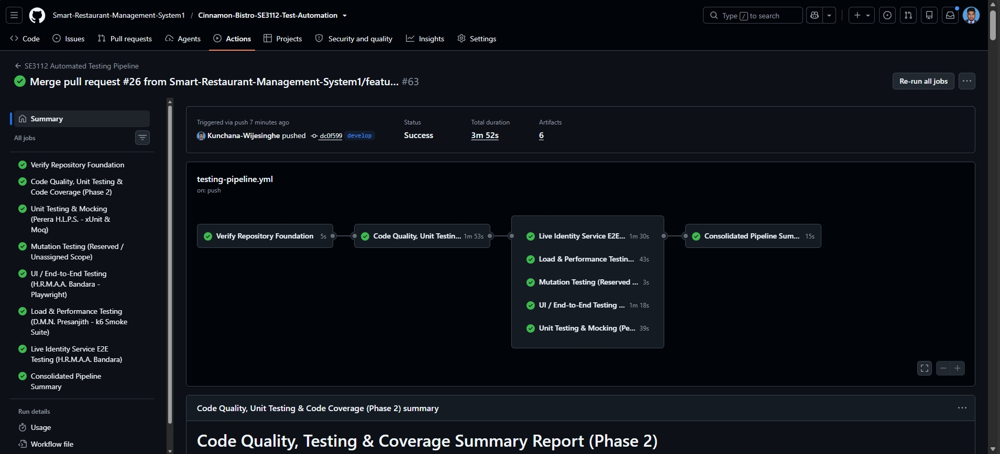

# Cinnamon Bistro SE3112 Automated Testing Pipeline

[](#)
[](#)
[](#)
[](#)
[](#)
[](#)

---

## 1. Project Overview & Decoupled Architecture

This repository hosts the centralized **Automated Testing & Quality Assurance Pipeline** developed for **SE3112: Advanced Software Engineering**.

It validates the **Cinnamon Bistro Cloud Services Platform (CSP)**, an enterprise distributed restaurant system built during SE3022. The application architecture consists of:
- **Frontend:** React 19 Single Page Application (`Vite`, `Tailwind CSS`, Port `5173`).
- **Identity Microservice:** ASP.NET Core (.NET 10 SDK, JWT Authentication, BCrypt, Port `5001`).
- **Reservation Microservice:** ASP.NET Core (.NET 10 SDK, Table Inventory & Booking Engine, Port `5000`).
- **Data & Messaging:** MySQL 8 Relational Database (Port `3306`) and Apache Kafka Event Streaming Bus (Port `9092`).

### Decoupled Testing Strategy
Rather than embedding testing harnesses inside the production application, this repository operates as a **100% decoupled, standalone quality engineering harness**:
- **Zero Production Intrusion:** Upstream application source code (`Smart-Restaurant-Management-System1/Smart-Restaurant-Management-System`) remains pristine and unmodified.
- **Dynamic Multi-Repo Orchestration:** The GitHub Actions CI runner dynamically checks out the external CSP repository into an ephemeral directory (`target-app/`) during workflow execution.
- **Independent Lifecycles:** Testing tooling, benchmark runners (Grafana k6), browser binaries (Playwright), and coverage instrumentation (Coverlet) evolve without triggering artificial application deployments.

---

## 2. Testing Areas & Assessment Allocation

In accordance with SE3112 curriculum guidelines, the testing strategy is structured into **four distinct individually assessed testing areas**, coordinated by a **shared group CI/CD automation pipeline**:

| Testing Area | Repository Directory | Ownership Classification | Individual / Lead Owner | Primary Scope & Objectives | Implementation Status |
| :--- | :--- | :--- | :--- | :--- | :---: |
| **Code Quality & Metrics** | [`quality-checks/`](quality-checks/) | **Individual Area 1** | **Wijesinghe K**<br>`IT24102587` | Static code analysis, linters, baseline regression gating, Coverlet coverage, and dual-source reporting. | **VERIFIED & ACTIVE (PR #16)** |
| **UI / End-to-End Testing** | [`e2e-tests/`](e2e-tests/) | **Individual Area 2** | **H.R.M.A.A. Bandara**<br>`IT24100315` | Automated customer journeys (Auth, Menu, Table Booking) using Playwright & headless Chromium via route mocking. | **VERIFIED & ACTIVE (PR #12, PR #13)** |
| **Unit Testing & Mocking** | [`unit-tests/`](unit-tests/) | **Individual Area 3** | **Perera H.L.P.S.**<br>`IT24101848` | Microservice unit tests, parameterized tests (`[Theory]`), and Moq test doubles isolating repository dependencies (204 tests). | **VERIFIED & ACTIVE (PR #11, PR #13, PR #15)** |
| **Load & Performance Testing**| [`load-tests/`](load-tests/) | **Individual Area 4** | **D.M.N. Presanjith**<br>`IT24101505` | Microservice load testing, concurrency profiles (Smoke, Baseline, Load, Stress), and SLA threshold evaluation. | **VERIFIED & ACTIVE (PR #8, PR #9)** |
| **Test Automation Pipeline** | [`.github/workflows/`](.github/workflows/) | **Shared Group Requirement** | **Wijesinghe K** *(Lead)*<br>*(All Members Contribute)* | Unified CI/CD workflow orchestration, automated test execution, dual coverage reporting, step summaries, and downloadable CI artifacts. | **VERIFIED & ACTIVE (PR #13, PR #15, PR #16)** |
| *Mutation Testing* | [`mutation-tests/`](mutation-tests/) | *Exploratory / Unassigned* | *None (Reserved)* | Retained in directory structure for potential exploration; **not** an individually assessed scope. | *Reserved Scope / Informational* |

---

## 3. Repository Structure

```text
Cinnamon-Bistro-SE3112-Test-Automation/
├── .github/
│   └── workflows/
│       └── testing-pipeline.yml   # Unified 8-stage GitHub Actions CI/CD workflow (All 4 stages + Live E2E active)
├── .config/
│   └── dotnet-tools.json          # Pinned local tool manifest (ReportGenerator 5.5.11)
├── docs/
│   ├── architecture.md            # SUT architecture & test harness design model
│   ├── testing-plan.md            # Master QA strategy, tooling & quality gates
│   ├── team-contribution.md       # Team responsibilities, RACI & demo deliverables
│   ├── team-integration-guide.md  # Detailed team handover contracts & isolation rules
│   └── academic-demo-guide.md     # Spoken pitch script & technical defense guide
├── quality-checks/                # Phase 1 & 2 Static analysis, coverage gates & runners (Wijesinghe K)
│   ├── baselines/
│   │   └── eslint-baseline.json   # Flat ESLint historical baseline signatures (129 findings)
│   ├── compare-eslint-baseline.js # Composite multiset signature regression gate evaluator
│   ├── coverlet.runsettings       # Coverlet assembly filtering configuration
│   ├── process-coverage.js        # Automated coverage threshold gate evaluator
│   ├── process-dual-coverage.js   # Dual-source coverage parser & markdown summary generator (PR #16)
│   ├── process-dual-coverage.test.js # 13 automated parser unit tests
│   ├── run-quality-checks.sh      # Cross-platform Bash pipeline harness
│   └── run-quality-checks.ps1     # Cross-platform PowerShell pipeline harness
├── unit-tests/                    # Isolated xUnit domain tests & Moq doubles (Perera H.L.P.S.)
│   ├── Authentication/            # Login, registration, and JWT token generator unit tests
│   ├── Authorization/             # Role authorization contract reflection tests
│   ├── Pricing/                   # Order cart subtotal decimal arithmetic & quantity tests
│   ├── Reservation/               # Lifecycle, reschedule, availability validator & service tests (204 tests)
│   ├── Support/                   # FixedTimeProvider deterministic test double
│   ├── CinnamonBistro.UnitTests.csproj # .NET 10 standalone test project
│   └── README.md                  # Unit test case inventory, prerequisites & commands
├── e2e-tests/                     # Playwright automated customer journeys (H.R.M.A.A. Bandara)
│   ├── tests/
│   │   ├── public-ui.spec.js      # Public landing, navigation, auth redirects & login validation (8 tests)
│   │   └── customer-mocked-ui.spec.js # Menu filters, cart journey & reservation search (5 tests)
│   ├── helpers/
│   │   └── fixtures.js            # In-memory route mocks & session state generators
│   ├── scripts/
│   │   ├── start-app.mjs          # Local Vite dev server runner for React frontend
│   │   └── capture-report.mjs     # HTML report snapshot utility
│   ├── playwright.config.js       # Playwright runner configuration (Chromium, HTML/JUnit reporters)
│   ├── package.json               # Playwright dependencies & npm scripts
│   └── README.md                  # E2E test inventory, mock strategy & VIVA runbook
├── load-tests/                    # Load & performance test suites (D.M.N. Presanjith)
│   ├── scripts/
│   │   ├── smoke.js               # 1 VU, 10s sanity & healthcheck script
│   │   ├── baseline.js            # 2 VUs, 30s low-concurrency baseline script
│   │   ├── reservation-load.js    # Ramp to 20 VUs, 60s load benchmark script
│   │   ├── stress.js              # Ramp to 40 VUs, 65s concurrency stress script
│   │   └── shared.js              # Shared HTTP 200, valid JSON, and available checks
│   ├── evidence/                  # Raw execution logs, SVG comparison chart & evidence index
│   ├── LOAD_TESTING_REPORT.md     # Comprehensive technical performance test report
│   └── results-summary.md         # Multi-profile latency and throughput comparison summary
├── mutation-tests/                # Reserved exploratory scope (Not individually assessed)
├── scripts/                       # Automation and runner helper scripts
│   ├── process-load-summary.js    # k6 summary JSON parser & GITHUB_STEP_SUMMARY generator
│   └── README.md                  # Script guidelines, standards, and utilities documentation
├── test-reports/                  # Consolidated output directory for CI artifacts (.gitkeep)
├── .gitignore                     # Git exclusion rules (private logs, test-reports, caches)
└── README.md                      # Project overview, team roles & documentation hub
```

---

## 4. Team Contributions & Governance Roster

Each team member owns exactly one distinct individual testing area. The shared CI/CD pipeline is coordinated by the Group Leader with active integration by all members:

| Student Name | Student ID | Individual Testing Area | Group Role | Implementation Deliverables & Verifiable PRs |
| :--- | :---: | :--- | :--- | :--- |
| **Wijesinghe K** | `IT24102587` | **Code Quality & Metrics** | **Group Leader & CI Pipeline Lead** | • Decoupled repository architecture and branching governance.<br>• Unified 8-job GitHub Actions pipeline (`testing-pipeline.yml`) consolidating regression and live identity testing.<br>• ESLint baseline regression gate ($\Delta_{\text{new errors}} = 0$).<br>• Automated execution of 570 unit tests & Coverlet coverage.<br>• Dual-source coverage reporting architecture (`process-dual-coverage.js`, PR #16).<br>• Automated dual-source coverage parser regression gate in CI (13 unit tests, PR #21).<br>• Integrated live Identity containerized E2E testing stage with ephemeral MySQL and zero residual records.<br>• Full CI activation of all testing stages with consolidated reporting and 6 downloadable artifacts.<br>• Authored team handover guide (`docs/team-integration-guide.md`, PR #5). |
| **Perera H.L.P.S.** | `IT24101848` | **Unit Testing & Mocking** | QA Automation Engineer | • Authored standalone xUnit project (`CinnamonBistro.UnitTests.csproj`).<br>• Implemented 204 unit tests across Authentication, Authorization, Pricing, and Reservation.<br>• 48 reservation lifecycle & rescheduling tests added via PR #15.<br>• In-memory Moq test doubles isolating repository & Kafka dependencies.<br>• Parameterized tests (`[Theory]`) for boundary and interval analysis.<br>• Fully integrated into CI with TRX and Cobertura reporting (PR #11, PR #13, PR #15). |
| **H.R.M.A.A. Bandara**| `IT24100315` | **UI / End-to-End Testing** | QA Automation Engineer | • Authored Playwright browser automation suite (`e2e-tests/`).<br>• Implemented 13 customer journey tests across Public UI and Mocked Customer UI.<br>• Network-isolated API route mocking via `page.route()` for deterministic CI.<br>• Authored live Identity integration suite (3 tests against real Identity Service & MySQL, PR #18) and local reservation test.<br>• Authored live test orchestration harness (`run-live.mjs`, `compose.mysql.yml`, `redact-reporter.mjs`).<br>• Integrated into CI with JUnit XML, HTML reports, and screenshots (PR #12, PR #13, PR #18, PR #22). |
| **D.M.N. Presanjith**| `IT24101505` | **Load & Performance Testing**| QA Automation Engineer | • Authored Grafana k6 performance suite (`load-tests/scripts/`).<br>• Executed 4 local workload profiles (Smoke, Baseline, Load, Stress).<br>• Automated CI smoke testing gate targeting reservation availability & metrics endpoints.<br>• Verified expanded CI smoke gate (40 requests, 140/140 checks passed in Run #54; historical single-endpoint baseline: p95 11.53ms, 60/60 checks).<br>• Authored `LOAD_TESTING_REPORT.md` and `results-summary.md` (PR #8, PR #9, PR #20). |

---

## 5. GitHub Actions CI/CD Pipeline Implementation

The CI/CD pipeline definition ([`.github/workflows/testing-pipeline.yml`](.github/workflows/testing-pipeline.yml)) runs on `ubuntu-latest` and is triggered on every `push` and `pull_request` targeting `develop` and `main`.

### Pipeline DAG Workflow Topology
```text
[1. foundation-check] ──► [2. quality-checks] ──► Parallel Concurrent Execution:
       (PASSED)                  (PASSED)               ├──► [3. unit-tests       (xUnit + Moq: 204 tests - PASSED)]
                                                        ├──► [4. e2e-tests        (Playwright: 13 mocked tests - PASSED)]
                                                        ├──► [5. load-tests       (k6 Smoke Profile - PASSED)]
                                                        ├──► [6. mutation-tests   (Reserved Notice)]
                                                        └──► [7. live-identity-e2e (Playwright Live + Docker MySQL - PASSED)]
                                                                      │
[8. publish-reports] ◄────────────────────────────────────────┘
       (PASSED — Consolidated Dual Coverage, Live E2E Audit & Pipeline Gate)
```

### Stage Execution Breakdown
1. **`foundation-check` (`PASSED`, ~8s):** Validates directory structure taxonomy, script executability, and workspace cleanliness.
2. **`quality-checks` (`PASSED`, ~2m 01s):**
   - Dynamically checks out the CSP application into `target-app/`.
   - Restores .NET 10 SDK and repository-local tools manifest (`ReportGenerator` v5.5.11).
   - Audits React frontend via baseline-aware ESLint gate: catalogs 129 legacy findings, verifies **$\Delta_{\text{new errors}} = 0$**.
   - Validates .NET 10 static build and audits NuGet dependencies (**0 vulnerabilities detected**).
   - Automatically executes **570 pre-existing CSP unit tests** (100% pass rate: 122 Identity, 448 Reservation).
   - Collects Coverlet coverage and enforces automated quality gate floors via `process-coverage.js` (**44.9% Line**, **42.4% Branch**).
   - Generates interactive HTML dashboard and uploads `quality-and-coverage-reports` artifact bundle.
3. **`unit-tests` (`PASSED`, ~25s — PR #11, PR #13, PR #15):**
   - Checks out CSP into `target-app/` and provisions .NET 10 SDK.
   - Restores and executes `unit-tests/CinnamonBistro.UnitTests.csproj` with `-p:TargetAppRoot=${{ github.workspace }}/target-app`.
   - Executes **204 standalone unit tests** with Moq doubles (100% pass rate, 0 failed, 0 skipped).
   - Collects TRX results and Coverlet Cobertura XML using `quality-checks/coverlet.runsettings`; uploads `unit-test-reports` artifact bundle.
   - Publishes execution breakdown table to `$GITHUB_STEP_SUMMARY`.
4. **`e2e-tests` (`PASSED`, ~1m 15s — PR #12, PR #13):**
   - Sets up Node.js 20, installs CSP frontend dependencies (`npm ci --ignore-scripts`), and installs Playwright Chromium with OS libraries.
   - Launches React 19 frontend via Vite (`start-app.mjs`) on `http://127.0.0.1:5173`.
   - Executes **13 Playwright browser tests** in headless Chromium using network route mocking (100% pass rate, 0 failed, 0 skipped).
   - Generates JUnit XML, self-contained HTML report, and visual failure artifacts; uploads `e2e-test-reports` bundle.
   - Publishes test spec summary table to `$GITHUB_STEP_SUMMARY`.
5. **`load-tests` (`PASSED`, ~52s — PR #8, PR #9, PR #20):**
   - Launches isolated `reservation-service` in the background with `Kafka__PublisherEnabled=false` and `OrderExpiry__Enabled=false`.
   - Runs a 30-second bounded `curl` healthcheck probe against `GET /api/tables/availability`.
   - Executes pinned Grafana k6 (`v0.54.0`) expanded smoke suite: 40 requests across availability and metrics endpoints over 10 seconds.
   - Evaluates performance thresholds via `scripts/process-load-summary.js` (**40 requests**, **140/140 checks passed (100%)**, **0.00% error rate**, all SLA thresholds passed; historical single-endpoint baseline: p95 of 11.53ms, 60/60 checks).
   - Safely terminates background process via PID and uploads `load-testing-reports` artifact bundle.
6. **`mutation-tests` (`Reserved / Notice Only`, ~5s):** Explicitly logs notice confirming mutation testing is an unassigned exploratory scope.
7. **`live-identity-e2e` (`PASSED`, ~2m 06s — PR #18, PR #22, Unified STEP 185):**
   - Checks out CSP into `target-app/` and provisions .NET 10 SDK and Node.js 20.
   - Spins up ephemeral MySQL 8 container via Docker Compose ([`e2e-tests/live/compose.mysql.yml`](e2e-tests/live/compose.mysql.yml)) and applies SQL migrations.
   - Compiles and starts real ASP.NET Core Identity Service (`backend/identity-service`) on loopback port 15001.
   - Launches React 19 frontend via Vite on loopback port 15173.
   - Executes **3 live Playwright tests** ([`e2e-tests/live/tests/identity.live.spec.js`](e2e-tests/live/tests/identity.live.spec.js)) via `run-live.mjs`: user registration, profile retrieval, and invalid login rejection.
   - Asserts zero residual records (`Users` count = 0, `UserRoles` count = 0), performs clean container teardown, and uploads `live-identity-e2e-reports` bundle.
8. **`publish-reports` (`PASSED`, ~10s — PR #13, PR #16, PR #21, PR #26, Unified STEP 185):**
   - Depends on all 7 upstream jobs (`foundation-check`, `quality-checks`, `unit-tests`, `mutation-tests`, `e2e-tests`, `load-tests`, `live-identity-e2e`) with `if: always()`.
   - Downloads all 5 test report artifacts (`quality-and-coverage-reports`, `unit-test-reports`, `e2e-test-reports`, `load-testing-reports`, `live-identity-e2e-reports`).
   - Executes `quality-checks/process-dual-coverage.test.js` validating the reporting parser across 13 test invariants as a blocking gate (PR #21).
   - Executes `quality-checks/process-dual-coverage.js` to dynamically generate a dual-source coverage report separating baseline from independent unit metrics.
   - Appends `dual-coverage-summary.md` and consolidated 8-job execution status to `$GITHUB_STEP_SUMMARY`.
   - Uploads `dual-coverage-summary` artifact (the 6th artifact bundle) and enforces overall pipeline gate, halting on any failure across all assessed jobs (`foundation-check`, `quality-checks`, `unit-tests`, `e2e-tests`, `load-tests`, `live-identity-e2e`).

### Downloadable CI Artifact Bundles
Every passing pipeline execution packages and uploads consolidated artifacts accessible from the GitHub Actions run summary:

| Artifact Name | Source Directory | Key Included Files | Primary Purpose |
| :--- | :--- | :--- | :--- |
| **`quality-and-coverage-reports.zip`** | `test-reports/` | Cobertura XML, ESLint findings JSON, ReportGenerator HTML dashboard | Code quality & baseline coverage audit |
| **`unit-test-reports.zip`** | `test-reports/unit/` | `unit-test-results.trx`, `<guid>/coverage.cobertura.xml` | xUnit test execution logs & coverage |
| **`e2e-test-reports.zip`** | `test-reports/e2e/` | `junit.xml`, `report/index.html`, `artifacts/*.png` | Playwright test report & visual snapshots |
| **`load-testing-reports.zip`** | `test-reports/load/` | `smoke-summary.json`, `load-summary.md`, `backend.log`, `k6-execution.log` | k6 performance metrics & SLA verification |
| **`dual-coverage-summary.zip`** | `test-reports/coverage/` | `dual-coverage-summary.md` | Consolidated dual-source coverage comparison |
| **`live-identity-e2e-reports.zip`** | `test-reports/e2e-live/` | `junit.xml`, `report/index.html`, `run-summary.json`, `startup/*.log`, screenshots | Automated live Identity & ephemeral MySQL integration audit |

### CI Workflow Architecture: Unified 8-Job Pipeline

Following the architectural consolidation plan (STEP 185), the Cinnamon Bistro test automation framework operates as a single, unified GitHub Actions workflow ([`.github/workflows/testing-pipeline.yml`](.github/workflows/testing-pipeline.yml)) orchestrating **8 sequential and concurrent jobs** across isolated `ubuntu-latest` virtual environments:

```text
┌────────────────────────────────────────────────────────────────────────────────────────┐
│                        UNIFIED 8-JOB CI/CD PIPELINE ARCHITECTURE                       │
├────────────────────────────────────────────────────────────────────────────────────────┤
│ File: .github/workflows/testing-pipeline.yml                                            │
│ Triggers: push (develop, main, feature/IT24102587-unified-ci-pipeline),                │
│           pull_request (develop, main),                                                │
│           workflow_dispatch (Manual execution)                                         │
│ Permissions: contents: read                                                            │
│ DAG Topology: foundation-check ──► quality-checks ──► 5 Concurrent Jobs ──► publish-reports │
│ Concurrent Jobs: unit-tests | e2e-tests | load-tests | mutation-tests | live-identity-e2e│
│ Downloadable Artifacts: 6 comprehensive bundles published per passing execution       │
└────────────────────────────────────────────────────────────────────────────────────────┘
```

#### 1. Unified 8-Job Workflow Structure
1. **Verify Repository Foundation (`foundation-check`):** Validates directory structure taxonomy, shell script executability, and workspace cleanliness (~8s).
2. **Code Quality, Unit Testing & Code Coverage (Phase 2) (`quality-checks`):** Depends on Job 1. Dynamically checks out CSP (`target-app/`), restores .NET 10 tools, enforces ESLint baseline regression gate ($\Delta_{\text{new errors}} = 0$ against 129 legacy findings), executes **570 CSP baseline tests** (100% pass), and evaluates Coverlet quality floors ($\ge 40.0\%$ line, $\ge 35.0\%$ branch) (~2m 01s).
3. **Unit Testing & Mocking (`unit-tests`):** Depends on Job 2 (runs concurrently with Jobs 4–7). Restores and executes `unit-tests/CinnamonBistro.UnitTests.csproj` with Moq doubles isolating Kafka/database (**204 independent unit tests**, 100% pass rate) (~25s).
4. **UI / End-to-End Testing (`e2e-tests`):** Depends on Job 2 (runs concurrently with Jobs 3, 5, 6, 7). Installs Playwright Chromium, boots React/Vite on port 5173, and runs **13 mocked browser customer journeys** ([`e2e-tests/tests/public-ui.spec.js`](e2e-tests/tests/public-ui.spec.js), [`e2e-tests/tests/customer-mocked-ui.spec.js`](e2e-tests/tests/customer-mocked-ui.spec.js)) with `page.route()` in-memory network mocking (~1m 15s).
5. **Load & Performance Testing (`load-tests`):** Depends on Job 2 (runs concurrently with Jobs 3, 4, 6, 7). Boots isolated reservation microservice with `Kafka__PublisherEnabled=false`, healthchecks endpoint, and executes Grafana k6 expanded smoke suite across availability and metrics endpoints (40 requests, 10s, 0 failures, 140/140 checks passed) (~52s).
6. **Mutation Testing (Reserved / Informational) (`mutation-tests`):** Depends on Job 2 (runs concurrently with Jobs 3, 4, 5, 7). Non-blocking exploratory placeholder logging scope notice confirming mutation testing is unassigned and not an implemented group requirement (~5s).
7. **Live Identity Service E2E Testing (`live-identity-e2e`):** Depends on Job 2 (runs concurrently with Jobs 3, 4, 5, 6). Full-stack containerized integration testing on `ubuntu-latest`: checks out CSP into `target-app/`, restores .NET 10 SDK, compiles the real ASP.NET Core Identity Service (`backend/identity-service`), spins up an ephemeral MySQL 8 container via Docker Compose ([`e2e-tests/live/compose.mysql.yml`](e2e-tests/live/compose.mysql.yml)), applies SQL migrations, boots real React/Vite frontend on loopback, executes Bandara's 3 live Playwright tests ([`e2e-tests/live/tests/identity.live.spec.js`](e2e-tests/live/tests/identity.live.spec.js)) through `run-live.mjs`, validates zero residual database records (`Users` count = 0, `UserRoles` count = 0), tears down containers, and uploads `live-identity-e2e-reports` bundle (~2m 06s, timeout: 25m).
8. **Consolidated Pipeline Summary (`publish-reports`):** Depends on all 7 upstream jobs (`foundation-check`, `quality-checks`, `unit-tests`, `e2e-tests`, `load-tests`, `mutation-tests`, `live-identity-e2e`) with `if: always()`. Downloads all 5 upstream test report artifacts (`quality-and-coverage-reports`, `unit-test-reports`, `e2e-test-reports`, `load-testing-reports`, `live-identity-e2e-reports`), executes the Dual-Source Coverage Parser regression gate (13 unit tests via PR #21), generates dual-source coverage reports separating baseline and independent metrics, publishes consolidated markdown summary to `$GITHUB_STEP_SUMMARY`, uploads `dual-coverage-summary` artifact (6th artifact bundle), and evaluates overall pipeline gate status halting on any failure across all assessed jobs (`foundation-check`, `quality-checks`, `unit-tests`, `e2e-tests`, `load-tests`, `live-identity-e2e`) (~10s).

#### 2. Architecture Consolidation & Historical Verification Baseline
- **Evolutionary Consolidation:** Initially, the testing architecture utilized two decoupled workflows: `.github/workflows/testing-pipeline.yml` (7 jobs) and `.github/workflows/live-e2e.yml` (1 job). In STEP 185, these were unified into a single 8-job pipeline to streamline CI execution, provide single-pane visibility, and publish all 6 artifact bundles from one consolidated run.
- **Job Isolation Preserved:** Even within a unified workflow, GitHub Actions executes each job on an entirely distinct, clean `ubuntu-latest` virtual machine runner. This guarantees that `live-identity-e2e` (which launches Docker and ephemeral MySQL) remains strictly isolated from `e2e-tests` (which relies on in-memory route mocking) and `load-tests` (which boots the standalone reservation backend).
- **Historical Baseline Verification:** Prior to consolidation, the architecture was independently verified on branch `develop` (HEAD: `62268a9`) via PR #24 across two benchmark executions:
  1. Default CI Run #58 (7/7 jobs passed, 12m 10s, 5 artifacts)
  2. Live Identity E2E Run #4 (Multi-tier containerized run passed, 2m 06s, 1 artifact)
  These runs serve as our empirical baseline, confirming that all 8 testing stages execute cleanly and deterministically.
- **Reservation Live Test Separation:** The single reservation live test ([`e2e-tests/live/reservation/reservation.live.spec.js`](e2e-tests/live/reservation/reservation.live.spec.js)) requires multi-microservice orchestration across both Identity and Reservation microservices and remains a local opt-in harness. It is **not** executed by the automated CI workflow.

### Verified GitHub Actions CI Execution Evidence

Following the integration of Pull Request #26 on branch `develop` (merge commit [`dc0f599`](https://github.com/Smart-Restaurant-Management-System1/Cinnamon-Bistro-SE3112-Test-Automation/commit/dc0f5993855ff50b27b926dd934449ddfa0ce719)), the Cinnamon Bistro test automation framework executes as a single, unified 8-job pipeline ([`.github/workflows/testing-pipeline.yml`](.github/workflows/testing-pipeline.yml)). The screenshot below verifies the end-to-end execution of all eight jobs and the generation of all six downloadable artifact bundles in a single consolidated CI run.

#### Unified 8-Job CI Pipeline Execution



- **Workflow Name:** `SE3112 Automated Testing Pipeline`
- **Workflow File:** [`.github/workflows/testing-pipeline.yml`](.github/workflows/testing-pipeline.yml)
- **Primary Verified Run (Post-Merge `develop`):** [#63](https://github.com/Smart-Restaurant-Management-System1/Cinnamon-Bistro-SE3112-Test-Automation/actions/runs/39882033526)
- **Direct GitHub Actions URL:** [https://github.com/Smart-Restaurant-Management-System1/Cinnamon-Bistro-SE3112-Test-Automation/actions/runs/39882033526](https://github.com/Smart-Restaurant-Management-System1/Cinnamon-Bistro-SE3112-Test-Automation/actions/runs/39882033526)
- **Trigger:** `push` (post-merge event on branch `develop`)
- **Commit:** [`dc0f599`](https://github.com/Smart-Restaurant-Management-System1/Cinnamon-Bistro-SE3112-Test-Automation/commit/dc0f5993855ff50b27b926dd934449ddfa0ce719)
- **Execution Result:** **Success — 8 / 8 jobs passed (100%)**
- **Execution Duration:** 3m 52s (total run time)
- **Published Artifact Bundles:** **6 comprehensive bundles**
  1. `quality-and-coverage-reports` (Coverlet Cobertura XML, ESLint findings JSON, ReportGenerator HTML dashboard)
  2. `unit-test-reports` (`unit-test-results.trx`, Cobertura coverage XML)
  3. `e2e-test-reports` (Playwright JUnit XML, HTML report, visual snapshots)
  4. `load-testing-reports` (k6 `smoke-summary.json`, `load-summary.md`, service logs)
  5. `live-identity-e2e-reports` (Live Playwright JUnit XML, HTML report, `run-summary.json`, logs)
  6. `dual-coverage-summary` (`dual-coverage-summary.md` consolidating baseline and independent unit coverage)
- **Pre-Merge Validation Runs (PR #26):**
  - **Pull Request Run #62:** [Run #39881682390](https://github.com/Smart-Restaurant-Management-System1/Cinnamon-Bistro-SE3112-Test-Automation/actions/runs/39881682390) on commit `793124a` (`pull_request` event, 8/8 jobs passed, duration: 9m 07s, 6 artifacts generated).
  - **Feature Branch Push Run #61:** [Run #39881682379](https://github.com/Smart-Restaurant-Management-System1/Cinnamon-Bistro-SE3112-Test-Automation/actions/runs/39881682379) on commit `793124a` (`push` event, 8/8 jobs passed, duration: 11m 08s, 6 artifacts generated).
- **Stage-by-Stage Verification Highlights:**
  - **Repository Foundation (`foundation-check`):** Workspace structure taxonomy, shell script execution bits, and directory integrity verified (~8s).
  - **Code Quality & Coverage (`quality-checks`):** ESLint regression gate verified ($\Delta_{\text{new errors}} = 0$ against 129 legacy findings), **570 CSP baseline unit tests** executed and passed (100%), Coverlet quality floors enforced (44.9% Line $\ge 40.0\%$, 42.4% Branch $\ge 35.0\%$).
  - **Unit Testing & Mocking (`unit-tests`):** **204 independent unit tests** executed with Moq test doubles isolating repository and Kafka dependencies (100% pass rate, 0 failed, 0 skipped; Perera H.L.P.S. — Area 3).
  - **UI / End-to-End Testing (`e2e-tests`):** **13 mocked browser UI tests** executed headlessly via Playwright Chromium and `page.route()` network mocking across auth, navigation, and ordering flows (100% pass rate; Bandara H.R.M.A.A. — Area 2).
  - **Load & Performance Testing (`load-tests`):** Isolated reservation backend booted, healthcheck verified, Grafana k6 expanded smoke suite executed across availability and metrics endpoints (**40 requests**, **140/140 checks passed (100%)**, 0.00% error rate, all SLA thresholds satisfied; Presanjith D.M.N. — Area 4).
  - **Mutation Testing (`mutation-tests`):** Explicit reserved scope notice logged confirming mutation testing is unassigned and exploratory (~5s).
  - **Live Identity Service E2E Testing (`live-identity-e2e`):** Multi-tier containerized integration executed on `ubuntu-latest`: real ASP.NET Core Identity Service (port 15001), React/Vite frontend (port 15173), ephemeral MySQL 8 via Docker Compose, **3 live Playwright tests** passed (user registration, profile retrieval, invalid login rejection), zero residual DB records verified, clean container teardown.
  - **Consolidated Pipeline Summary (`publish-reports`):** Depends on all 7 upstream jobs (`needs: [foundation-check, quality-checks, unit-tests, mutation-tests, e2e-tests, load-tests, live-identity-e2e]`), downloads all 5 test report artifacts, executes **13 dual-source coverage parser regression tests**, generates dual coverage summary, posts consolidated execution summary to `$GITHUB_STEP_SUMMARY`, uploads `dual-coverage-summary` artifact, and evaluates pipeline status gate.
- **Historical Pre-Unification Baseline (Preserved for Reference):**
  - Prior to consolidation in STEP 185 (PR #26), the architecture was maintained across two decoupled workflows independently verified on branch `develop` (HEAD: `62268a9` via PR #24):
    - *Default CI Run #58:* [Run #39853809370](https://github.com/Smart-Restaurant-Management-System1/Cinnamon-Bistro-SE3112-Test-Automation/actions/runs/39853809370) (7/7 jobs passed, 12m 10s, 5 artifacts).
    - *Live Identity E2E Run #4:* [Run #39853809369](https://github.com/Smart-Restaurant-Management-System1/Cinnamon-Bistro-SE3112-Test-Automation/actions/runs/39853809369) (1/1 job passed, 2m 06s, 1 artifact).
  - The historical execution screenshots (`docs/images/automated-ci-run-58.png` and `docs/images/live-identity-e2e-run-4.png`) are preserved in [`docs/images/`](docs/images/) as documented audit assets.
- **Operational Boundary Notice:** The single live reservation customer journey ([`e2e-tests/live/reservation/reservation.live.spec.js`](e2e-tests/live/reservation/reservation.live.spec.js)) requires multi-microservice orchestration and is maintained strictly as an isolated local test harness. It is **not** executed within CI.

---

## 6. Verified Empirical Quality & Performance Metrics

All metrics reported below have been empirically measured and verified on branch `develop` (HEAD: `dc0f599`, Verified Integration: PR #15, PR #16, PR #18, PR #20, PR #21, PR #22, PR #23, PR #24, PR #26):

### 6.1 Code Quality & Coverage Metrics (Wijesinghe K)
- **Baseline CSP Unit Tests:** **570 / 570 Passed (100% pass rate)**.
  - *Academic Note:* These 570 tests exist in the base CSP application; the assessed contribution is automating their compilation, execution, Coverlet coverage instrumentation, and gate enforcement.
- **Baseline Line Coverage:** **`44.9%`** (1,478 / 3,288 lines) vs. **$\ge 40.0\%$ Quality Gate Floor** -> **`PASSED`**.
- **Baseline Branch Coverage:** **`42.4%`** (393 / 926 branches) vs. **$\ge 35.0\%$ Quality Gate Floor** -> **`PASSED`**.
- **Frontend ESLint Regression Gate:** **`PASSED`** ($\Delta_{\text{new errors}} = 0$ against 129 cataloged historical findings).
- **NuGet Vulnerability Audit:** **0 CVEs Detected** across all transitive dependencies.
- **Dual-Source Coverage Architecture (PR #16):** Automated by `quality-checks/process-dual-coverage.js`. Evaluates and publishes CSP baseline and independent unit suite metrics in two distinct sections without mathematical addition or averaging.
- **Reporting Parser Verification:** **13 / 13 Passed (100% pass rate)** in automated test suite (`quality-checks/process-dual-coverage.test.js`).

### 6.2 Unit Testing & Mocking Metrics (Perera H.L.P.S.)
- **Standalone xUnit Test Suite:** **204 / 204 Passed (100% pass rate)** across 11 test classes (expanded from 156 with 48 new tests via PR #15).
- **Failures:** `0` | **Skipped:** `0` | **Execution Time:** ~1.0 second.
- **Domain Coverage:**
  - *Authentication (39 tests):* `AuthService.LoginAsync`, `AuthService.RegisterAsync`, `JwtTokenGenerator.GenerateToken`.
  - *Reservation Validation & Policies (61 tests):* `AvailabilitySearchValidator`, `ReservationPolicies`, `ReservationCreationService`.
  - *Reservation Lifecycle & Rescheduling (48 tests — PR #15):*
    - `ReservationLifecycleServiceTests` (32 tests): Valid transitions (`Pending->Confirmed/Cancelled`, `Confirmed->Cancelled/Completed`), rejection of unknown/null/empty/case-mismatched statuses without querying repository (`Times.Never`), missing reservation (`NotFound`), disallowed transitions (`Conflict`), admin vs customer ID forwarding, customer cancellation outcomes (`Cancelled`, `NotFound`, `InvalidState`), CancellationToken forwarding, exception handling.
    - `ReservationRescheduleServiceTests` (16 tests): Reschedule delegation, outcome propagation across all domain outcomes (`Updated`, `NotFound`, `Forbidden`, `InvalidState`, `TableNotFound`, `Unavailable`), Admin vs Customer command structures, overlapping booking conflicts, table capacity exceeded, non-existent table, terminal state, CancellationToken forwarding, exception handling.
  - *Pricing & Cart (43 tests):* `OrderCartItem.Subtotal` exact decimal arithmetic, `OrderCartService` quantity boundaries (1..99).
  - *Authorization (13 tests):* Real controller `[Authorize]` attributes, cross-service role contracts.
- **Test Double Implementation:** In-memory `Moq` doubles (`Mock<IUserRepository>`, `Mock<IPasswordHasher>`, `Mock<IJwtTokenGenerator>`, `Mock<IReservationRepository>`, etc.) with strict invocation verifications (`Verify(..., Times.Once)` / `Times.Never`).
- **Parameterized Testing:** 32 `[Theory]` definitions testing boundary limits, midnight transitions, invalid statuses, and outcome mappings.
- **Independent Suite Coverage (Release Mode):**
  - **Line Coverage:** **`5.9%`** (171 / 2,886 lines)
  - **Branch Coverage:** **`10.3%`** (95 / 926 branches)
  - **Targeted Class Line & Branch Coverage:** `ReservationLifecycleService` (**100.0% Line**, **100.0% Branch**), `ReservationRescheduleService` (**100.0% Line**, **100.0% Branch**), `ReservationStatusTransitionPolicy` (**100.0% Line**, **100.0% Branch**).
  - **Compiler Denominator Note:** In Release builds (`net10.0`), compiler optimizations and method inlining reduce coverable sequence points to 2,886 lines (vs. 3,288 in Debug mode), while decision branches remain constant at 926 branches.
  - **Strict Non-Additive Policy:** Independent unit suite coverage validates isolated business logic with test doubles and is reported separately from the 570 CSP baseline integration tests. Baseline regression floors ($\ge 40\%$ line, $\ge 35\%$ branch) remain strictly enforced on baseline tests.

### 6.3 UI & End-to-End Testing Metrics (H.R.M.A.A. Bandara)
- **1. Default Mocked UI Browser Suite (Automated CI — `testing-pipeline.yml`):**
  - **Results:** **13 / 13 Passed (100% pass rate)** across 2 spec files in CI Run #54.
  - **Failures:** `0` | **Skipped:** `0` | **Execution Time:** ~1.3 minutes.
  - *Public UI (8 tests):* Landing navigation, section anchor focus (`#about`), mobile menu toggle & focus restoration, guest route guards (`/menu`, `/cart`, `/availability` -> `/login`), login form client validation, 401 alert handling, registration validation.
  - *Mocked Customer UI (5 tests):* Menu category/dietary filtering & search reset, menu 503 service error recovery via Retry, cart lifecycle (add, quantity increase/decrease, subtotal recomputation, removal), reservation search input validation, valid table search & reservation enablement.
  - *Isolation Mechanism:* Network-isolated route interception via `page.route()`; frontend served via Vite on port 5173. Zero live MySQL/Kafka required.
- **2. Live Identity Integration Suite (Automated CI — Unified Job `live-identity-e2e` in `testing-pipeline.yml`, previously `live-e2e.yml`):**
  - **Results:** **3 / 3 Passed (100% pass rate)** in GitHub Actions Live Run #1 ([Run #39840017647](https://github.com/Smart-Restaurant-Management-System1/Cinnamon-Bistro-SE3112-Test-Automation/actions/runs/39840017647)).
  - **Failures:** `0` | **Skipped:** `0` | **Playwright Duration:** 10.2 seconds.
  - *Scenarios:* Real browser registration with MySQL role verification (4.2s), real customer login & profile retrieval (2.9s), rejected wrong-password attempt with error feedback (1.6s).
  - *Live Infrastructure:* React/Vite frontend (port 15173), real ASP.NET Core / .NET 10 Identity Service (port 15001), ephemeral Docker MySQL 8 container (port 33079, `mysql:8.0.46`).
  - *Cleanup Verification:* `cleanupVerified: true`, zero remaining users (`0`), zero remaining user roles (`0`), Docker container and volume destroyed.
- **3. Opt-In Live Reservation Journey (Local Development Harness Only):**
  - **Scope:** 1 multi-step reservation booking and stale-tab concurrency conflict rejection test ([`reservation.live.spec.js`](e2e-tests/live/reservation/reservation.live.spec.js)).
  - **Local Requirement:** Requires pre-running local Identity (5001) and Reservation (5000) services with initialized database schemas. **Not** automated in CI.

### 6.4 Load & Performance Testing Metrics (D.M.N. Presanjith)
- **1. Automated GitHub Actions CI Expanded Smoke Gate (CI Run #54 — PR #20):**
  - **Executed Scenarios:** Two concurrent scenarios (`table_availability_smoke` and `prometheus_metrics_smoke`) over 10 seconds.
  - **Target Endpoints:** `GET /api/tables/availability` and `GET /metrics`.
  - **Total HTTP Requests:** **`40`** (20 requests per endpoint).
  - **Checks Evaluated:** **`140 / 140 passed (100.0%)`** (0 failed checks: 60 checks on availability JSON and structure, 80 checks on Prometheus text content and metric samples).
  - **HTTP Failures:** **`0.00%`** (0 / 40 failed).
  - **SLA Threshold Verification:** All configured thresholds passed (`p(95) < 1000ms`, `http_req_failed rate < 0.01`, `checks rate > 0.99`, `http_reqs count > 0` for both endpoints).
- **2. Historical Single-Endpoint CI Measurement (PR #9 Baseline):**
  - **Target Endpoint:** `GET /api/tables/availability` exclusively (1 VU, 10s).
  - **HTTP Requests:** 20 requests | **p95 Latency:** **`11.53 ms`** (Threshold: $p(95) < 1000\text{ms}$ -> **`PASSED`**, 86.7x safety margin).
  - **HTTP Failures:** `0.00%` (0 / 20 failed) | **Checks:** `60 / 60 passed (100.0%)`.
- **3. Four Local Workload Profiles (PR #8 Benchmarks):**
  - *Smoke (1 VU, 10s):* 20 requests, 1.99 req/s, p95: **`1.37 ms`**, 0.00% failures, 100% checks passed (**PASSED**).
  - *Baseline (2 VUs, 30s):* 120 requests, 3.99 req/s, p95: **`1.06 ms`**, 0.00% failures, 100% checks passed (**PASSED**).
  - *Load (20 VUs, 60s):* 1,120 requests, 18.61 req/s, p95: **`1.08 ms`**, 0.00% failures, 100% checks passed (**PASSED**).
  - *Stress (40 VUs, 65s):* 2,533 requests, 38.86 req/s, p95: **`1.19 ms`**, 0.00% failures, 100% checks passed (**PASSED**).
  - *Scope Delineation:* Only the Smoke profile executes in CI to prevent runner contention; multi-user profiles are local capacity benchmarks.

---

## 7. Local Setup & Execution Guide

### Prerequisites
- **Git** (2.40+)
- **.NET SDK 10.0** (`dotnet --version`)
- **Node.js 20.x or 22.x** and **npm** (`node --version`)
- *(Optional for local performance runs)* **Grafana k6** v0.54+ (`k6 version`)

### 1. Clone the Repositories
Clone the testing repository and the target CSP application into sibling directories:
```bash
git clone https://github.com/Smart-Restaurant-Management-System1/Cinnamon-Bistro-SE3112-Test-Automation.git
git clone https://github.com/Smart-Restaurant-Management-System1/Smart-Restaurant-Management-System.git target-app
```

### 2. Run Code Quality & Coverage Checks Locally
Restore pinned local tools, then execute the cross-platform harness:

**On Linux / macOS (Bash):**
```bash
cd Cinnamon-Bistro-SE3112-Test-Automation
dotnet tool restore
chmod +x quality-checks/run-quality-checks.sh
./quality-checks/run-quality-checks.sh ../target-app
```

**On Windows (PowerShell):**
```powershell
cd Cinnamon-Bistro-SE3112-Test-Automation
dotnet tool restore
.\quality-checks\run-quality-checks.ps1 -TargetAppPath ..\target-app
```
*Generated reports will be available under `test-reports/quality/` and `test-reports/coverage/reports/index.html`.*

### 3. Run Standalone Unit Tests Locally (Area 3 — Perera H.L.P.S.)
Execute Perera's 204 xUnit tests directly against the sibling CSP reference:

```powershell
cd Cinnamon-Bistro-SE3112-Test-Automation
dotnet restore unit-tests/CinnamonBistro.UnitTests.csproj -p:TargetAppRoot=../target-app
dotnet test unit-tests/CinnamonBistro.UnitTests.csproj --configuration Release -p:TargetAppRoot=../target-app --settings quality-checks/coverlet.runsettings --logger "trx;LogFileName=unit-test-results.trx" --results-directory test-reports/unit --collect:"XPlat Code Coverage"
```
*Results will be generated at `test-reports/unit/unit-test-results.trx` (204 passed) and `test-reports/unit/<guid>/coverage.cobertura.xml`.*

### 4. Run UI / End-to-End Tests Locally (Area 2 — H.R.M.A.A. Bandara)
Install dependencies and run Playwright in headless or headed mode:

```powershell
cd Cinnamon-Bistro-SE3112-Test-Automation/e2e-tests
npm ci
npx playwright install chromium

# Run all 13 tests headlessly with auto-managed Vite frontend server
$env:E2E_APP_PATH = "../target-app"
npm test

# Optional: Run headed mode to view browser interactions
node node_modules/@playwright/test/cli.js test --headed --grep "add to cart"
```
*Generated reports will be available at `test-reports/e2e/junit.xml` and `test-reports/e2e/report/index.html`.*

### 5. Run Load & Performance Tests Locally (Area 4 — D.M.N. Presanjith)
Start the reservation microservice locally in an isolated terminal:
```bash
cd target-app/backend/reservation-service
export Kafka__PublisherEnabled=false
export OrderExpiry__Enabled=false
dotnet run --urls "http://localhost:5000"
```

In another terminal, execute k6 test profiles from the testing repository:
```bash
cd Cinnamon-Bistro-SE3112-Test-Automation

# Smoke Profile (1 VU, 10s)
k6 run --summary-export=test-reports/load/smoke-summary.json load-tests/scripts/smoke.js

# Baseline Profile (2 VUs, 30s)
k6 run --summary-export=test-reports/load/baseline-summary.json load-tests/scripts/baseline.js

# Load Profile (Ramp to 20 VUs, 60s)
k6 run --summary-export=test-reports/load/load-summary.json load-tests/scripts/reservation-load.js

# Stress Profile (Ramp to 40 VUs, 65s)
k6 run --summary-export=test-reports/load/stress-summary.json load-tests/scripts/stress.js
```

### 6. Generate Dual-Source Coverage Report & Run Parser Tests
Generate the consolidated dual-source coverage report separating baseline from independent metrics:

```powershell
cd Cinnamon-Bistro-SE3112-Test-Automation

# Run automated reporting parser unit tests (13 tests)
node --test quality-checks/process-dual-coverage.test.js

# Process and generate dual-source Markdown summary
node quality-checks/process-dual-coverage.js `
  --baseline-json test-reports/coverage/reports/Summary.json `
  --unit-dir test-reports/unit `
  --output test-reports/coverage/dual-coverage-summary.md
```
*Generated report will be available at `test-reports/coverage/dual-coverage-summary.md`.*

---

## 8. Documentation Hub & Key Links

- **Testing Repository:** [Cinnamon-Bistro-SE3112-Test-Automation](https://github.com/Smart-Restaurant-Management-System1/Cinnamon-Bistro-SE3112-Test-Automation)
- **Target CSP Application:** [Smart-Restaurant-Management-System](https://github.com/Smart-Restaurant-Management-System1/Smart-Restaurant-Management-System)
- **CI/CD Workflow Definition:** [`.github/workflows/testing-pipeline.yml`](.github/workflows/testing-pipeline.yml)
- **Architecture Specification:** [`docs/architecture.md`](docs/architecture.md)
- **Quality Assurance Master Plan:** [`docs/testing-plan.md`](docs/testing-plan.md)
- **Team Ownership & RACI Matrix:** [`docs/team-contribution.md`](docs/team-contribution.md)
- **Team Integration Handover Guide:** [`docs/team-integration-guide.md`](docs/team-integration-guide.md)
- **Academic Presentation Pitch Guide:** [`docs/academic-demo-guide.md`](docs/academic-demo-guide.md)
- **Code Quality Harness Documentation:** [`quality-checks/README.md`](quality-checks/README.md)
- **Unit Testing Suite Documentation:** [`unit-tests/README.md`](unit-tests/README.md)
- **UI / E2E Testing Suite Documentation:** [`e2e-tests/README.md`](e2e-tests/README.md)
- **Load Testing Suite Documentation:** [`load-tests/README.md`](load-tests/README.md)
- **Load Testing Empirical Report:** [`load-tests/LOAD_TESTING_REPORT.md`](load-tests/LOAD_TESTING_REPORT.md)
- **Load Testing Results Summary:** [`load-tests/results-summary.md`](load-tests/results-summary.md)
- **Automation Scripts Documentation:** [`scripts/README.md`](scripts/README.md)

---

*Repository maintained by Wijesinghe K (`IT24102587`), CI/CD Pipeline Lead & Group Leader.*
