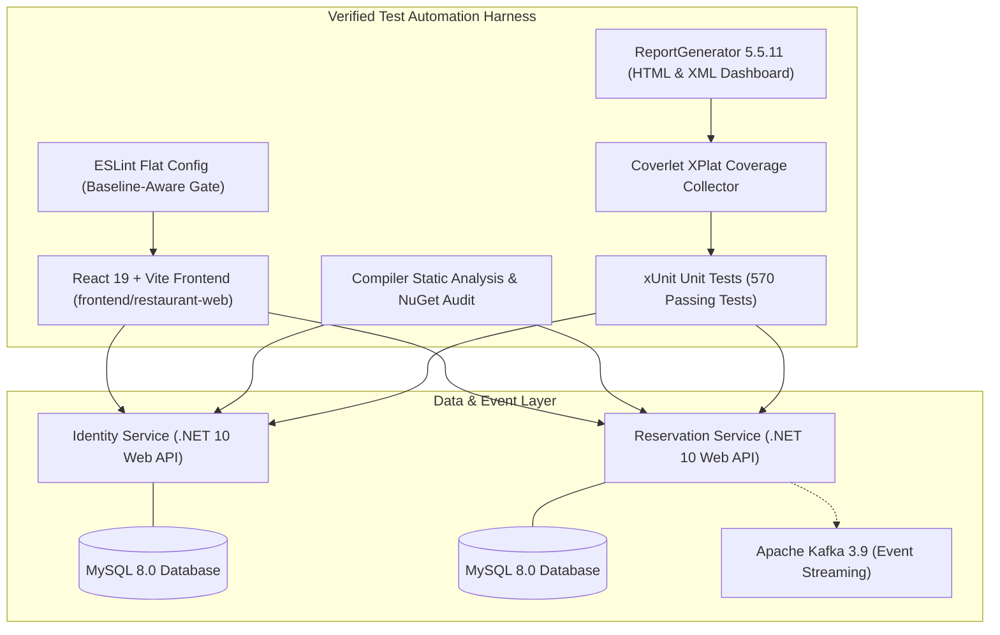
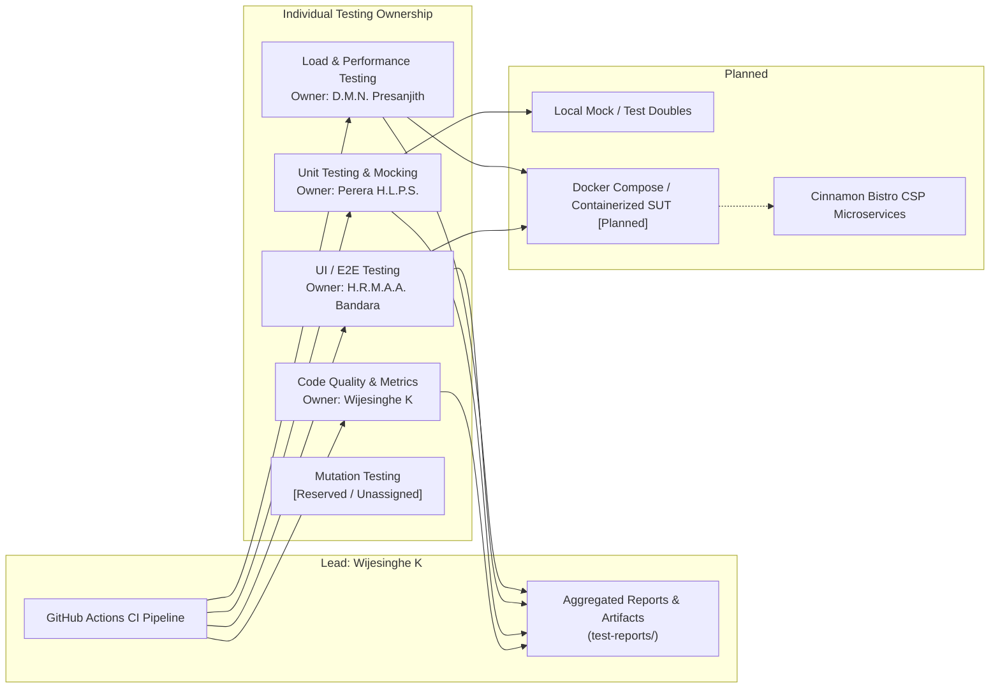

# Test Automation Architecture & System Overview

## 1. Introduction & Context

This document defines the architectural model for the **SE3112 Advanced Software Engineering** automated quality assurance repository, designed to validate the **Cinnamon Bistro SE3022 Cloud Services Platform (CSP)**.

### Decoupling Principle: System Under Test (SUT) vs. Test Automation Harness
A fundamental engineering principle of this project is the strict separation between the target application and the automated test harness:
- **SE3022 Cinnamon Bistro CSP (Application Repository)**: Contains the production application codebase, domain microservices, persistence logic, API gateway implementations, and operational infrastructure.
- **SE3112 Test Automation (This Repository)**: Operates strictly as an **external quality engineering harness**. It does not modify application business logic. Instead, it interacts with the microservices through public contracts, HTTP/REST endpoints, client interfaces, or isolated service-level tests.

---

## 2. System Under Test (SUT): Cinnamon Bistro CSP (Verified Architecture)

Technical inspection of the Cinnamon Bistro CSP repository (`Smart-Restaurant-Management-System1/Smart-Restaurant-Management-System`, `develop` branch) confirms the following verified architecture:

### Verified Architecture Specifications
- **Identity Service**: ASP.NET Core (.NET 10), BCrypt password hashing, JWT authentication, MySQL persistence. (122 xUnit tests).
- **Reservation Service**: ASP.NET Core (.NET 10), table reservations, order tracking, billing/invoicing, feedback management, Kafka outbox event publishing. (448 xUnit tests).
- **Frontend Web Application**: React 19, Vite, React Router DOM, Axios, ESLint 10.9.1 (Flat Config).
- **Coverage Engine**: Coverlet DataCollector (`6.0.0`) producing Cobertura XML; aggregated via `dotnet-reportgenerator-globaltool` (`5.5.11`).

---

## 3. Test Automation Pipeline Architecture & Ownership

The automated testing harness is structured into distinct, modular validation layers executing within a shared CI/CD workflow:

---

## 4. Layered Quality Strategy & Responsibility Matrix

| Quality Layer | Target Boundary | Isolation Strategy | Responsible Owner | Primary Assessment Scope |
| :--- | :--- | :--- | :--- | :--- |
| **Code Quality & Metrics** | Test repo & application codebases | Static analysis (no execution required) | **Wijesinghe K** `IT24102587` | Linters, SAST security scanners, cyclomatic complexity metrics, quality gate enforcement, and CI orchestration. |
| **Unit Testing & Mocking** | Service business logic, algorithms, state | Complete isolation using test doubles (mocks, stubs) | **Perera H.L.P.S.** `IT24101848` | Service-level business rule validation, parameterized tests, boundary conditions, and exception recovery. |
| **UI / End-to-End (E2E) Testing** | User interface & service integrations | Headless browser execution against running SUT | **H.R.M.A.A. Bandara** `IT24100315` | Automated browser tests, customer journey verification (auth, menu, orders, reservations where supported), and UI regression. |
| **Load & Performance Testing** | Public endpoints & microservice APIs | Synthetic virtual user concurrency | **D.M.N. Presanjith** `IT24101505` | Stress profiles, latency distributions (p90/p95/p99), throughput (RPS), and SLA threshold evaluation. |
| *Mutation Testing* | *Unit test assertions & mutants* | *Synthetic fault injection* | *Unassigned (Exploratory)* | *Preserved in folder structure for potential future exploration; not an assessed individual scope.* |
| **CI/CD Pipeline Orchestration** | Entire repository testing workflow | GitHub Actions hosted runners | **Shared Group Requirement** *(Led by Wijesinghe K)* | Automated pipeline trigger on PR/push, stage execution, unified report aggregation, and artifact archiving. |

---

## 5. Artifact & Report Management

All testing tools are configured to output results to the centralized `test-reports/` directory.

### Target Reporting Architecture (Planned Implementation)
1. **Quality Checks**: Static analysis results, security audit logs, and code quality summaries (`test-reports/quality/`).
2. **Unit Tests**: Test execution logs, JUnit XML output, and LCOV/JaCoCo coverage reports (`test-reports/unit/`).
3. **UI / E2E Tests**: Test execution summaries, failure screenshots, and execution trace videos (`test-reports/e2e/`).
4. **Load Tests**: Performance summaries, latency percentiles, and k6 JSON results (`test-reports/load/`).
5. **CI Aggregation**: The GitHub Actions pipeline aggregates all reports and uploads them as persistent workflow artifacts upon pipeline completion.
