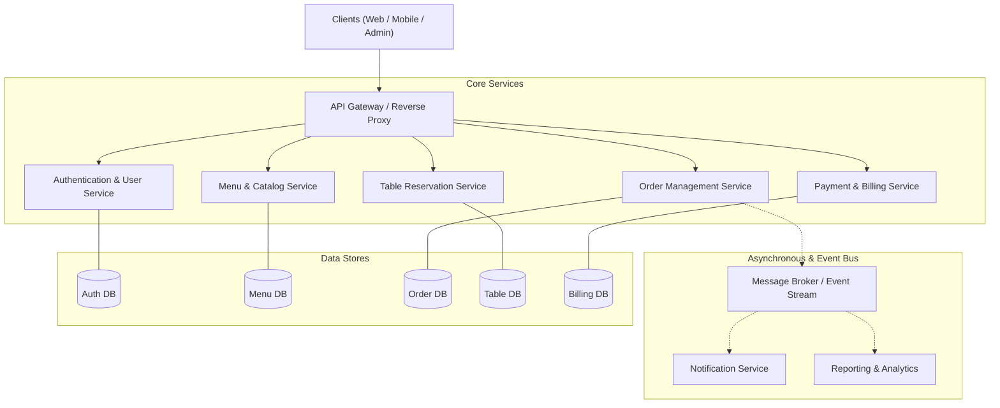
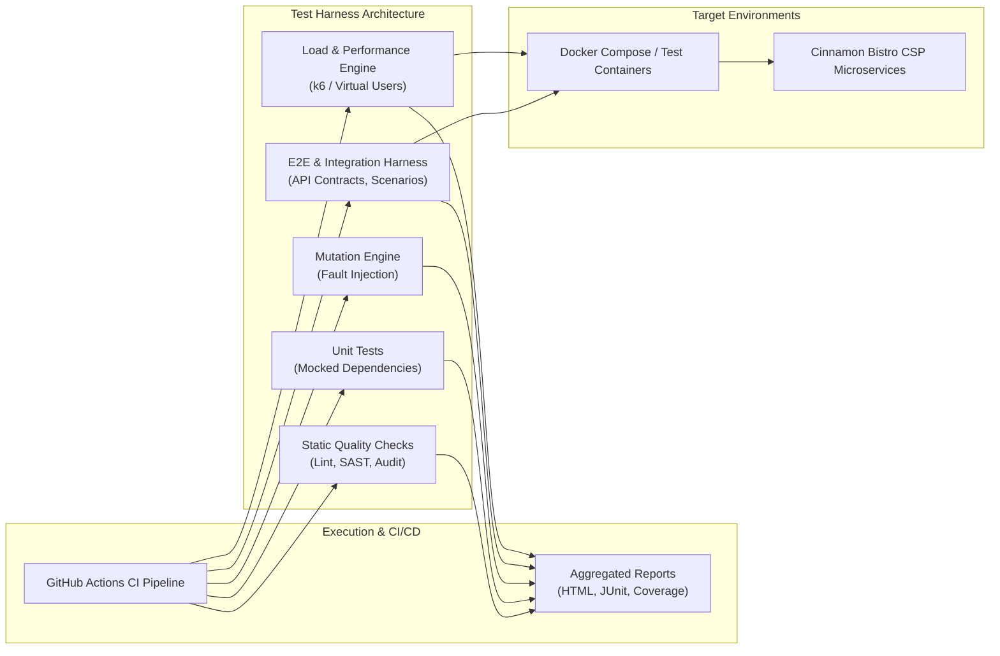

# Test Automation Architecture & System Overview

## 1. Introduction & Context

This document outlines the testing architecture for the **SE3112 Advanced Software Engineering** quality assurance initiative, targeting the **Cinnamon Bistro SE3022 Cloud Services Platform (CSP)**.

Cinnamon Bistro is an enterprise-grade restaurant management and customer ordering platform designed as a distributed microservice system. To ensure zero-downtime reliability, data integrity, and strict SLA compliance, this repository decouples testing harnesses, synthetic workloads, and verification pipelines from the operational codebase.

---

## 2. System Under Test (SUT): Cinnamon Bistro CSP

The Cinnamon Bistro CSP microservice architecture typically consists of distinct distributed domains:

### Key Architectural Characteristics
- **Loosely Coupled Services**: Microservices communicate over RESTful APIs and asynchronous message queues.
- **Polyglot & Isolated Persistence**: Microservices maintain independent databases preventing cross-domain schema coupling.
- **Dynamic Routing & Security**: Centralized API Gateway handles rate limiting, authentication verification, and route proxying.

---

## 3. Test Automation Pipeline Architecture

The automated testing harness operates as an external, multi-tier validation layer interacting with the Cinnamon Bistro CSP microservices across various deployment environments (Local Mock, CI Ephemeral Containers, and Staging).

---

## 4. Layered Quality Strategy

| Test Layer | Target Boundary | Isolation Strategy | Verification Goal |
| :--- | :--- | :--- | :--- |
| **Quality Checks** | Source Code & Configs | Static (no execution) | Ensure code style, catch common vulnerabilities, and maintain dependency hygiene. |
| **Unit Testing** | Classes, Methods, Business Logic | Full Isolation (stubs, mocks, fakes) | Verify algorithms, state transitions, validation rules, and error handling. |
| **Mutation Testing** | Unit Test Assertions & Logic | Fault Injection | Validate that test assertions fail when code mutants are introduced (killing mutants). |
| **End-to-End (E2E)** | API Gateway & Service Chains | Ephemeral containerized instances | Ensure integrated user workflows (e.g., browse menu -> reserve table -> place order -> bill payment). |
| **Load Testing** | Ingress, Endpoints, Persistence | Target service instances under load | Benchmark throughput (RPS), p95/p99 latency, degradation thresholds, and stability under peak traffic. |

---

## 5. Artifact & Report Management

All testing tools are configured to output machine-readable and human-readable reports to the centralized `test-reports/` directory.

During CI execution in GitHub Actions:
1. Each job writes test outcomes (e.g., JUnit XML, lcov coverage, HTML dashboards).
2. The CI pipeline bundles these outputs into persistent downloadable workflow artifacts.
3. Quality gates evaluate coverage and pass/fail thresholds before signaling merge readiness.

