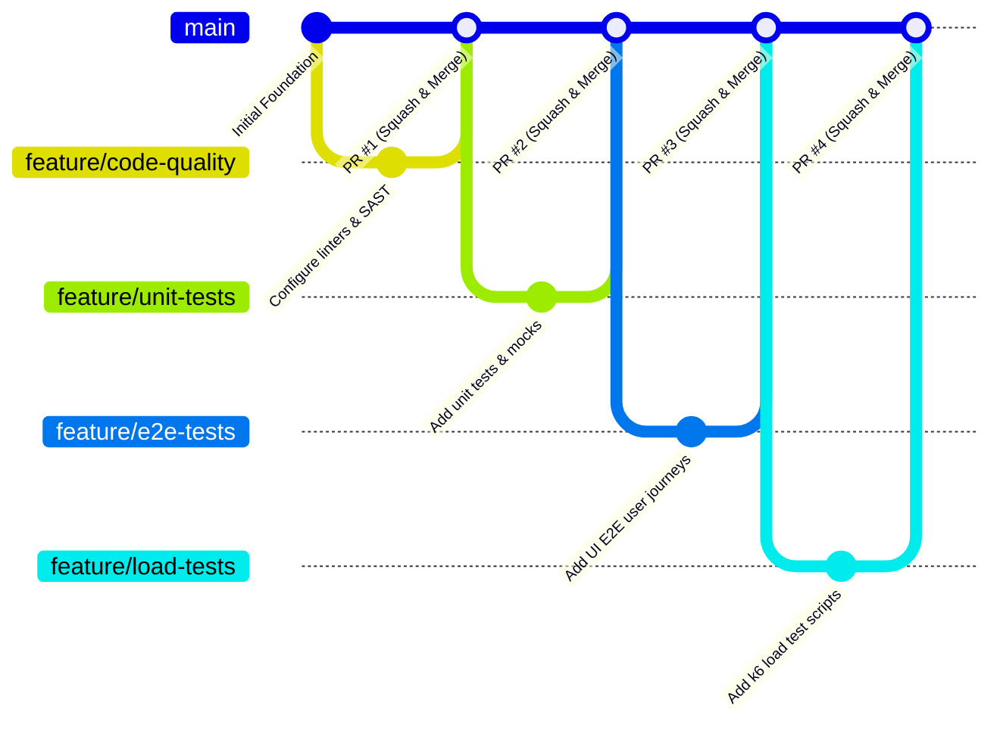

# Team Contribution & Engineering Governance

## 1. Overview

This document defines the team composition, role assignments, development workflow, responsibility matrix, and demo deliverables for the **SE3112 Advanced Software Engineering** automated testing repository.

This project validates the **Cinnamon Bistro SE3022 Cloud Services Platform (CSP)**. Under SE3112 evaluation rules:
- There are **exactly four distinct individual testing areas**, each owned by one team member.
- The **overall Test Automation Pipeline** (CI/CD orchestration) is a **shared group requirement** collaboratively supported by all members and led by the Group Leader.
- **Mutation Testing** is **not** selected as an individual testing area and is **not** presented as a completed group requirement.

---

## 2. Team Roster & Individual Testing Ownership

| Student Name | Student ID | Individual Testing Area | Additional Group Role | Assigned Focus & Primary Responsibilities |
| :--- | :--- | :--- | :--- | :--- |
| **Wijesinghe K** | `IT24102587` | **Code Quality & Metrics** | **Group Leader / Pipeline Lead** | • GitHub repository and branch policy management • Overall test automation architecture and CI/CD orchestration • GitHub Actions pipeline setup, stages, and integration • Static code analysis and code quality metrics configuration (ESLint baseline regression gate) • Automated execution of 570 CSP baseline tests & Coverlet quality gate floors (>= 40% Line, >= 35% Branch) • Dual-source coverage reporting architecture (`process-dual-coverage.js`, PR #16) • Automated dual-source coverage parser regression gate in CI (13 unit tests, `process-dual-coverage.test.js`, PR #21) • Standalone manual Live Identity E2E workflow orchestration (`live-e2e.yml`, PR #22) • Multi-stage GitHub Actions pipeline (`testing-pipeline.yml`, 7 jobs) maintaining strict default CI isolation • Integration of all members' testing suites into CI with consolidated summaries and artifacts |
| **H.R.M.A.A. Bandara** | `IT24100315` | **UI / End-to-End (E2E) Testing** | QA Engineer (UI/E2E) | • Automated frontend testing and realistic user workflows using Playwright (13 default browser tests) • End-to-end customer journeys across Public UI (8 tests) and Mocked Customer UI (5 tests) • Authored live Identity integration suite (3 tests against real Identity Service & MySQL, PR #18) and local reservation test • Authored live test orchestration harness (`run-live.mjs`, `compose.mysql.yml`, `redact-reporter.mjs`) • Deterministic in-memory API route mocking via `page.route()` for network isolation • Integration of E2E test suite into CI with JUnit XML, HTML reports, and failure screenshots |
| **Perera H.L.P.S.** | `IT24101848` | **Unit Testing & Mocking** | QA Engineer (Unit/Mocking) | • Standalone xUnit 2.5.3 test project (`CinnamonBistro.UnitTests.csproj`) with 204 unit tests • Comprehensive service testing across Authentication, Authorization, Pricing, and Reservation • Expanded reservation lifecycle & rescheduling coverage (48 new tests via PR #15) • In-memory Moq 4.20.70 test doubles isolating repository & Kafka dependencies with `Times.Never` negative assertions • Integration into CI with dynamic TRX and Coverlet Cobertura reporting |
| **D.M.N. Presanjith** | `IT24101505` | **Load & Performance Testing** | QA Engineer (Performance) | • Performance and load testing using Grafana k6 across 4 workload profiles (Smoke, Baseline, Load, Stress) • Automated CI smoke testing gate targeting reservation availability & metrics endpoints • Execution of expanded CI smoke suite in Run #54 (40 requests, 140/140 checks passed, 0.00% failure rate; historical single-endpoint baseline: p95 11.53ms, 60/60 checks) • Technical performance documentation (`LOAD_TESTING_REPORT.md` and `results-summary.md`) |

---

## 3. Contribution & Branching Workflow

All development activity follows a structured feature-branch workflow to maintain stability on the `main` branch.

### 3.1 Branch Naming Conventions
- `feature/quality-<description>` — Used by Wijesinghe K for static analysis, metrics, and quality checks.
- `feature/unit-<description>` — Used by Perera H.L.P.S. for unit test suites and mock fixtures.
- `feature/e2e-<description>` — Used by H.R.M.A.A. Bandara for UI and E2E test flows.
- `feature/load-<description>` — Used by D.M.N. Presanjith for performance and load test scripts.
- `ci/<description>` — Used by Wijesinghe K (with team consultation) for pipeline orchestration.
- `fix/<issue-description>` — Bug fixes for pipeline or test harness issues.
- `docs/<topic>` — Documentation updates and test plan maintenance.

### 3.2 Commit Message Standards (Conventional Commits)
Commits must be clear, descriptive, and follow the Conventional Commits specification:
- `feat(quality): configure static code analysis rules and linter`
- `feat(unit): add parameterized tests for order calculation service`
- `feat(e2e): implement automated customer login and menu selection journey`
- `feat(load): create 100-user concurrency benchmark for menu endpoint`
- `ci(pipeline): integrate e2e test execution stage and report upload`
- `docs(team): update responsibility matrix and demo deliverables`

### 3.3 Pull Request & Code Review Responsibilities
1. **Self-Verification**: Author runs their test suite locally and ensures clean execution prior to opening a PR.
2. **Automated CI Validation**: The PR must trigger GitHub Actions; all active pipeline checks must pass.
3. **Peer Review**: At least one other team member must review the PR for test maintainability, mock isolation, and coding standards.
4. **Pipeline Lead Approval**: Group Leader (Wijesinghe K) reviews CI impact, path changes, and report output configuration before merge.
5. **No Direct Pushes to `main`**: All contributions must enter `main` via reviewed pull requests.

---

## 4. Responsibility Matrix (RACI)

The table below delineates individual ownership from shared group requirements:

| Milestone / Testing Deliverable | Wijesinghe K `IT24102587` | H.R.M.A.A. Bandara `IT24100315` | Perera H.L.P.S. `IT24101848` | D.M.N. Presanjith `IT24101505` |
| :--- | :---: | :---: | :---: | :---: |
| **CI/CD Pipeline Orchestration & Branch Policies** *(Shared Group Requirement)* | **A / R** | C | C | C |
| **Code Quality & Metrics** *(Individual Area 1)* | **A / R** | I | I | I |
| **UI / End-to-End (E2E) Testing** *(Individual Area 2)* | I | **A / R** | I | I |
| **Unit Testing & Mocking** *(Individual Area 3)* | I | I | **A / R** | I |
| **Load & Performance Testing** *(Individual Area 4)* | I | I | I | **A / R** |
| *Mutation Testing (Reserved / Unassigned Scope)* | — | — | — | — |
| **Cross-Suite CI Integration & Pipeline Triggers** | **A / R** | **R** | **R** | **R** |
| **Unified Test Reporting & Final Group Demo** | **A / R** | **R** | **R** | **R** |

*Legend: **A** = Accountable (Final ownership & approval), **R** = Responsible (Directly implements), **C** = Consulted (Provides input), **I** = Informed (Kept updated)*

> **Note on Mutation Testing**: Mutation testing is preserved as an optional exploratory directory in the repository structure, but is **not** assigned to any team member and is **not** claimed as a completed group requirement.

---

## 5. Individual Demo Ownership & Expected Evidence

Each team member is independently responsible for presenting their individual testing area during the final project demonstration, providing verifiable technical evidence:

### 5.1 Wijesinghe K (`IT24102587`) — Code Quality & Metrics / Group Lead
- **Demo Ownership**: Static analysis workflow, code metrics dashboards, quality gate policies, and end-to-end CI pipeline execution.
- **Expected Evidence**:
  - Configured linter rules and static analysis scanner outputs (ESLint baseline regression gate $\Delta_{\text{new errors}} = 0$ against 129 legacy findings).
  - Automated compilation, execution, and Coverlet coverage collection for 570 CSP baseline tests (44.9% Line, 42.4% Branch).
  - Automated PR blocking on quality gate floor violations (Line $\ge 40.0\%$, Branch $\ge 35.0\%$).
  - Dual-source coverage reporting architecture (`process-dual-coverage.js`, PR #16) with 13 automated parser unit tests (`process-dual-coverage.test.js`).
  - Automated dual-source coverage parser CI regression gate (PR #21), executing all 13 unit tests as a blocking gate before report publishing.
  - Standalone manual Live Identity E2E workflow orchestration (`.github/workflows/live-e2e.yml`, PR #22), enabling on-demand containerized testing in GitHub Actions (Run #1: 3/3 passed) while preserving default CI isolation (Run #54: 7/7 passed).
  - Working GitHub Actions CI workflow executing all integrated test stages and publishing downloadable artifacts (`quality-and-coverage-reports`, `dual-coverage-summary`, `live-identity-e2e-reports`).

### 5.2 H.R.M.A.A. Bandara (`IT24100315`) — UI / End-to-End (E2E) Testing
- **Demo Ownership**: Automated UI test execution, customer journeys, positive/negative paths, and CI execution.
- **Expected Evidence**:
  - Automated E2E test scripts (Playwright) executing 13 browser tests in headless Chromium against the Cinnamon Bistro frontend.
  - Realistic user workflows: authentication, landing navigation, section focus, menu category/dietary filtering, cart lifecycle, and reservation search.
  - Negative UI scenarios: invalid credentials, guest route guards (`/menu`, `/cart` -> `/login`), menu 503 retry recovery, and form validation errors.
  - In-memory route mocking via `page.route()` for network-isolated, deterministic execution in default CI (0 live MySQL/Kafka dependencies).
  - Authored live Identity integration suite (3 tests in `identity.live.spec.js`) and test harness (`run-live.mjs`, `compose.mysql.yml`, `redact-reporter.mjs`) exercising real React frontend, real ASP.NET Core / .NET 10 Identity Service, and ephemeral Docker MySQL 8 with automated cleanup verification.
  - Authored local opt-in live reservation test (`reservation.live.spec.js`) for booking and stale-tab concurrency validation.
  - Video recordings, screenshot artifacts on failure, JUnit XML, and HTML execution reports generated within the CI pipeline.

### 5.3 Perera H.L.P.S. (`IT24101848`) — Unit Testing & Mocking
- **Demo Ownership**: Isolated unit tests, parameterized scenarios, mock/stub verifications, and exception testing.
- **Expected Evidence**:
  - Comprehensive standalone xUnit test suite (`CinnamonBistro.UnitTests.csproj`) with 204 unit tests (156 baseline + 48 reservation lifecycle & rescheduling tests added via PR #15).
  - Parameterized tests (`[Theory]`) verifying boundary values, midnight transitions, invalid status rejections, and outcome mappings.
  - In-memory Moq test doubles (`Mock<IReservationRepository>`, `Mock<IUserRepository>`, etc.) with strict invocation verifications (`Verify(..., Times.Once)` / `Times.Never`).
  - Positive, negative, cancellation token forwarding, and exception handling tests ensuring unswallowed errors.
  - Measured Release-mode statement/branch coverage (5.9% line, 10.3% branch) with 100% line & branch coverage on `ReservationLifecycleService`, `ReservationRescheduleService`, and `ReservationStatusTransitionPolicy`.

### 5.4 D.M.N. Presanjith (`IT24101505`) — Load & Performance Testing
- **Demo Ownership**: Automated load test execution, concurrency ramp-up, throughput and latency benchmarking, and threshold evaluation.
- **Expected Evidence**:
  - Load testing scripts (Grafana k6) targeting Cinnamon Bistro reservation microservice availability and metrics endpoints.
  - Four locally executed workload profiles: Smoke (1 VU), Baseline (2 VUs), Load (20 VUs), and Stress (40 VUs).
  - Automated CI expanded smoke testing gate executing 40 requests across availability and metrics endpoints over 10 seconds in Run #54.
  - Metric dashboards and logs showing: 140/140 checks passed (100.0%), 0.00% failure rate, and all SLA thresholds passing in Run #54 (historical single-endpoint smoke baseline achieved p95 latency of 11.53ms < 1000ms SLA with 20 requests and 60/60 checks).
  - Comprehensive technical performance documentation (`load-tests/LOAD_TESTING_REPORT.md` and `load-tests/results-summary.md`).

---

## 6. Peer Review Checklist

Before approving any pull request, reviewers must verify:
- [ ] Test code adheres strictly to the author's assigned individual testing scope.
- [ ] Tests are deterministic and do not contain arbitrary timeouts or flaky sleep statements.
- [ ] Mocks and stubs properly decouple the test from production infrastructure and external networks.
- [ ] Assertions verify tangible business outcomes and contracts rather than trivial or tautological truths.
- [ ] The change does not break existing CI workflow stages or invalidate shared reporting paths.
- [ ] All generated test output paths target the centralized `test-reports/` directory.

---

## 7. Shared Pipeline Integration Contracts for Teammates

As Group Leader and Shared Pipeline Integration Lead, Wijesinghe K has established standardized integration contracts to enable seamless check-in of teammate test suites:

### 7.1 Unit Testing & Mocking Contract (Perera H.L.P.S. — `IT24101848`)
- **Target Repository Directory:** `unit-tests/`
- **Recommended Technology:** xUnit, Moq, FluentAssertions (`.NET 10`)
- **Entry Point Execution:** `dotnet test unit-tests/CinnamonBistro.UnitTests.csproj -c Release -p:TargetAppRoot=../target-app --settings quality-checks/coverlet.runsettings --collect:"XPlat Code Coverage"`
- **Expected Artifacts:** Cobertura XML and TRX test results placed in `test-reports/unit/`
- **Environment Prerequisites:** None (fully isolated with test doubles and mocks)
- **CI Failure Handling:** Non-zero exit code halts the pipeline with mandatory gate failure.
- **Integration Note:** Delivered and verified at 204 unit tests (100% pass rate). The CI pipeline dynamically counts test results from TRX and extracts independent Cobertura coverage alongside the 570 baseline integration tests without combining percentages.

### 7.2 UI / End-to-End (E2E) Testing Contract (H.R.M.A.A. Bandara — `IT24100315`)
- **Target Repository Directory:** `e2e-tests/`
- **Recommended Technology:** Playwright or Cypress (Node.js 20)
- **Entry Point Execution:** `npm run test:e2e` or `npx playwright test --config=e2e-tests/playwright.config.js`
- **Expected Artifacts:** HTML report, screenshot on failure, and execution video placed in `test-reports/e2e/`
- **Environment Prerequisites:** `BASE_URL=http://localhost:5173` (React frontend) and backend services running or mocked via WireMock / Prism
- **CI Failure Handling:** Failure marks the E2E stage as failed; failure screenshots uploaded as CI artifacts.

### 7.3 Load & Performance Testing Contract (D.M.N. Presanjith — `IT24101505`)
- **Target Repository Directory:** `load-tests/`
- **Recommended Technology:** Grafana k6 (portable binary or Docker)
- **Entry Point Execution:** `k6 run load-tests/scripts/reservation-service-load.js --summary-export=test-reports/load/summary.json`
- **Expected Artifacts:** JSON execution summary and Markdown report placed in `test-reports/load/`
- **Environment Prerequisites:** `TARGET_API_URL=http://localhost:5000` (target service endpoint)
- **CI Failure Handling:** Threshold breach (p95 latency > 500ms, error rate > 1%) returns exit code 99 and flags the performance gate.

### 7.4 Teammate Integration Checklist
Prior to merging into `develop`, each teammate must verify:
1. Test suite executes locally via standard CLI without proprietary IDE dependencies.
2. Output artifacts are directed to `test-reports/<area>/` rather than scattered in the source tree.
3. PR adheres to Conventional Commits: `feat(unit):`, `feat(e2e):`, or `feat(load):`.
4. Tests do not modify original CSP source code or overwrite other team members' directories.
