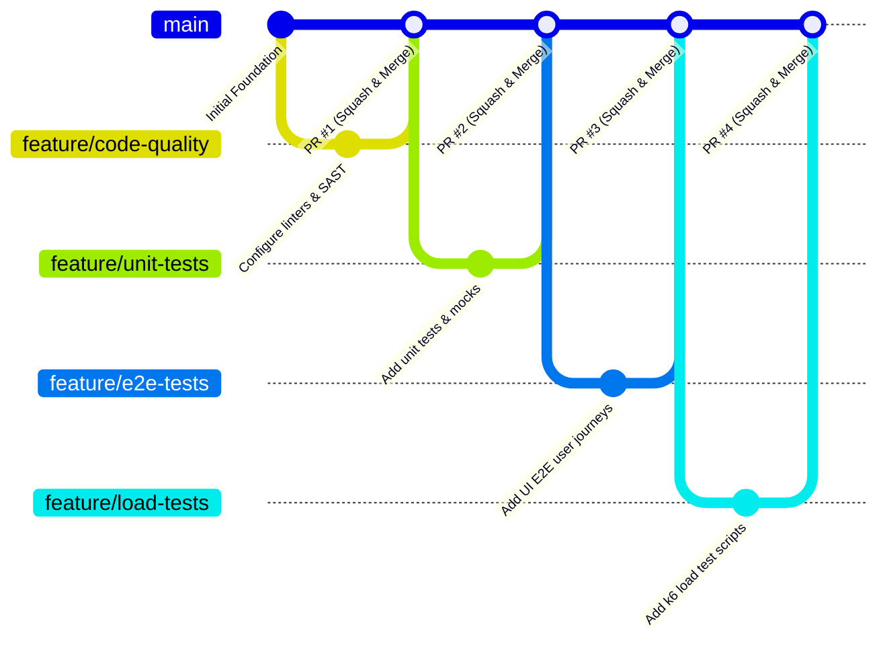

# Team Contribution & Engineering Governance

## 1. Overview

This document defines the team composition, role assignments, development workflow, responsibility matrix, and demo deliverables for the **SE3112 Advanced Software Engineering** automated testing repository.

This project validates the **Cinnamon Bistro SE3022 Cloud Services Platform (CSP)**. Under SE3112 evaluation rules:
- There are **exactly four distinct individual testing areas**, each owned by one team member.
- The **overall Test Automation Pipeline** (CI/CD orchestration) is a **shared group requirement** collaboratively supported by all members and led by the Group Leader.
- **Mutation Testing** is **not** selected as an individual testing area and is **not** presented as a completed group requirement.

---

## 2. Team Roster & Individual Testing Ownership

| Student Name | Student ID | Individual Testing Area | Additional Group Role | Assigned Focus & Primary Responsibilities |
| :--- | :--- | :--- | :--- | :--- |
| **Wijesinghe K** | `IT24102587` | **Code Quality & Metrics** | **Group Leader / Pipeline Lead** | • GitHub repository and branch policy management • Overall test automation architecture and CI/CD orchestration • GitHub Actions pipeline setup, stages, and integration • Static code analysis and code quality metrics configuration • Quality gates, coverage tracking, and code quality reporting • Integration of other members' testing suites into CI • Unified test reporting, documentation, and final group demo coordination |
| **H.R.M.A.A. Bandara** | `IT24100315` | **UI / End-to-End (E2E) Testing** | QA Engineer (UI/E2E) | • Automated frontend testing and realistic user workflows • End-to-end user journeys (authentication, menu browsing, ordering, or reservation where supported by actual CSP application) • Positive and negative UI test scenarios • Integration of E2E test suite into the CI pipeline • Generation of E2E execution results and demonstration evidence |
| **Perera H.L.P.S.** | `IT24101848` | **Unit Testing & Mocking** | QA Engineer (Unit/Mocking) | • Service-level unit testing and component validation • Parameterized test suites covering boundary conditions • Test doubles implementation including mocks, stubs, and spies • Business rule validation, input checks, and exception-handling tests • Generation of unit test execution reports and test evidence |
| **D.M.N. Presanjith** | `IT24101505` | **Load & Performance Testing** | QA Engineer (Performance) | • Performance and load testing of selected microservice endpoints • Definition of realistic concurrency and workload profiles • Measurement of response times, throughput (RPS), and failure rates • Establishment of performance degradation thresholds and SLA compliance • Generation of load test reports and performance demonstration evidence |

---

## 3. Contribution & Branching Workflow

All development activity follows a structured feature-branch workflow to maintain stability on the `main` branch.

### 3.1 Branch Naming Conventions
- `feature/quality-<description>` — Used by Wijesinghe K for static analysis, metrics, and quality checks.
- `feature/unit-<description>` — Used by Perera H.L.P.S. for unit test suites and mock fixtures.
- `feature/e2e-<description>` — Used by H.R.M.A.A. Bandara for UI and E2E test flows.
- `feature/load-<description>` — Used by D.M.N. Presanjith for performance and load test scripts.
- `ci/<description>` — Used by Wijesinghe K (with team consultation) for pipeline orchestration.
- `fix/<issue-description>` — Bug fixes for pipeline or test harness issues.
- `docs/<topic>` — Documentation updates and test plan maintenance.

### 3.2 Commit Message Standards (Conventional Commits)
Commits must be clear, descriptive, and follow the Conventional Commits specification:
- `feat(quality): configure static code analysis rules and linter`
- `feat(unit): add parameterized tests for order calculation service`
- `feat(e2e): implement automated customer login and menu selection journey`
- `feat(load): create 100-user concurrency benchmark for menu endpoint`
- `ci(pipeline): integrate e2e test execution stage and report upload`
- `docs(team): update responsibility matrix and demo deliverables`

### 3.3 Pull Request & Code Review Responsibilities
1. **Self-Verification**: Author runs their test suite locally and ensures clean execution prior to opening a PR.
2. **Automated CI Validation**: The PR must trigger GitHub Actions; all active pipeline checks must pass.
3. **Peer Review**: At least one other team member must review the PR for test maintainability, mock isolation, and coding standards.
4. **Pipeline Lead Approval**: Group Leader (Wijesinghe K) reviews CI impact, path changes, and report output configuration before merge.
5. **No Direct Pushes to `main`**: All contributions must enter `main` via reviewed pull requests.

---

## 4. Responsibility Matrix (RACI)

The table below delineates individual ownership from shared group requirements:

| Milestone / Testing Deliverable | Wijesinghe K `IT24102587` | H.R.M.A.A. Bandara `IT24100315` | Perera H.L.P.S. `IT24101848` | D.M.N. Presanjith `IT24101505` |
| :--- | :---: | :---: | :---: | :---: |
| **CI/CD Pipeline Orchestration & Branch Policies** *(Shared Group Requirement)* | **A / R** | C | C | C |
| **Code Quality & Metrics** *(Individual Area 1)* | **A / R** | I | I | I |
| **UI / End-to-End (E2E) Testing** *(Individual Area 2)* | I | **A / R** | I | I |
| **Unit Testing & Mocking** *(Individual Area 3)* | I | I | **A / R** | I |
| **Load & Performance Testing** *(Individual Area 4)* | I | I | I | **A / R** |
| *Mutation Testing (Reserved / Unassigned Scope)* | — | — | — | — |
| **Cross-Suite CI Integration & Pipeline Triggers** | **A / R** | **R** | **R** | **R** |
| **Unified Test Reporting & Final Group Demo** | **A / R** | **R** | **R** | **R** |

*Legend: **A** = Accountable (Final ownership & approval), **R** = Responsible (Directly implements), **C** = Consulted (Provides input), **I** = Informed (Kept updated)*

> **Note on Mutation Testing**: Mutation testing is preserved as an optional exploratory directory in the repository structure, but is **not** assigned to any team member and is **not** claimed as a completed group requirement.

---

## 5. Individual Demo Ownership & Expected Evidence

Each team member is independently responsible for presenting their individual testing area during the final project demonstration, providing verifiable technical evidence:

### 5.1 Wijesinghe K (`IT24102587`) — Code Quality & Metrics / Group Lead
- **Demo Ownership**: Static analysis workflow, code metrics dashboards, quality gate policies, and end-to-end CI pipeline execution.
- **Expected Evidence**:
  - Configured linter rules and static analysis scanner outputs (e.g., SonarQube / ESLint / Trivy).
  - Code quality metrics: cyclomatic complexity, duplication rates, and maintainability indices.
  - Automated PR blocking on quality gate violations.
  - Working GitHub Actions CI workflow executing all integrated test stages and publishing downloadable artifacts.

### 5.2 H.R.M.A.A. Bandara (`IT24100315`) — UI / End-to-End (E2E) Testing
- **Demo Ownership**: Automated UI test execution, customer journeys, positive/negative paths, and CI execution.
- **Expected Evidence**:
  - Automated E2E test scripts (e.g., Playwright / Cypress / Selenium) executing against the Cinnamon Bistro frontend/API.
  - Realistic user workflows: authentication, menu navigation, item selection, order submission (where supported by actual CSP application).
  - Negative UI scenarios: invalid credentials, form validation errors, session timeout handling.
  - Video recordings, screenshot artifacts on failure, and HTML execution reports generated within the CI pipeline.

### 5.3 Perera H.L.P.S. (`IT24101848`) — Unit Testing & Mocking
- **Demo Ownership**: Isolated unit tests, parameterized scenarios, mock/stub verifications, and exception testing.
- **Expected Evidence**:
  - Comprehensive unit test suites validating core service logic (e.g., pricing, order calculations, status checks).
  - Parameterized tests verifying boundary values and equivalence partitions.
  - Test double configurations (mocks, stubs, spies) cleanly isolating services from databases and external HTTP calls.
  - Positive, negative, and exception handling tests ensuring graceful recovery.
  - Test execution logs and statement/branch code coverage reports (e.g., lcov / JaCoCo / Jest HTML reports).

### 5.4 D.M.N. Presanjith (`IT24101505`) — Load & Performance Testing
- **Demo Ownership**: Automated load test execution, concurrency ramp-up, throughput and latency benchmarking, and threshold evaluation.
- **Expected Evidence**:
  - Load testing scripts (e.g., k6 / JMeter) targeting key Cinnamon Bistro microservice endpoints.
  - Configured workload profiles: ramp-up, sustained peak, and ramp-down scenarios with simulated concurrent virtual users.
  - Metric dashboards and logs showing: request rate (RPS), response times (min, avg, p90, p95, p99), error rates, and connection duration.
  - Clear demonstration of performance pass/fail thresholds aligned with defined SLAs.

---

## 6. Peer Review Checklist

Before approving any pull request, reviewers must verify:
- [ ] Test code adheres strictly to the author's assigned individual testing scope.
- [ ] Tests are deterministic and do not contain arbitrary timeouts or flaky sleep statements.
- [ ] Mocks and stubs properly decouple the test from production infrastructure and external networks.
- [ ] Assertions verify tangible business outcomes and contracts rather than trivial or tautological truths.
- [ ] The change does not break existing CI workflow stages or invalidate shared reporting paths.
- [ ] All generated test output paths target the centralized `test-reports/` directory.

---

## 7. Shared Pipeline Integration Contracts for Teammates

As Group Leader and Shared Pipeline Integration Lead, Wijesinghe K has established standardized integration contracts to enable seamless check-in of teammate test suites:

### 7.1 Unit Testing & Mocking Contract (Perera H.L.P.S. — `IT24101848`)
- **Target Repository Directory:** `unit-tests/`
- **Recommended Technology:** xUnit, Moq, FluentAssertions (`.NET 10`)
- **Entry Point Execution:** `dotnet test unit-tests/` (or designated `.csproj` under `unit-tests/`)
- **Expected Artifacts:** Cobertura XML or TRX test results placed in `test-reports/unit/`
- **Environment Prerequisites:** None (fully isolated with test doubles and mocks)
- **CI Failure Handling:** Non-zero exit code halts the pipeline with mandatory gate failure.
- **Integration Note:** The Code Quality stage executes the 570 baseline unit tests to calculate statement/branch coverage. Perera's suite will expand coverage on new business rules and parameterized edge cases.

### 7.2 UI / End-to-End (E2E) Testing Contract (H.R.M.A.A. Bandara — `IT24100315`)
- **Target Repository Directory:** `e2e-tests/`
- **Recommended Technology:** Playwright or Cypress (Node.js 20)
- **Entry Point Execution:** `npm run test:e2e` or `npx playwright test --config=e2e-tests/playwright.config.js`
- **Expected Artifacts:** HTML report, screenshot on failure, and execution video placed in `test-reports/e2e/`
- **Environment Prerequisites:** `BASE_URL=http://localhost:5173` (React frontend) and backend services running or mocked via WireMock / Prism
- **CI Failure Handling:** Failure marks the E2E stage as failed; failure screenshots uploaded as CI artifacts.

### 7.3 Load & Performance Testing Contract (D.M.N. Presanjith — `IT24101505`)
- **Target Repository Directory:** `load-tests/`
- **Recommended Technology:** Grafana k6 (portable binary or Docker)
- **Entry Point Execution:** `k6 run load-tests/scripts/reservation-service-load.js --summary-export=test-reports/load/summary.json`
- **Expected Artifacts:** JSON execution summary and Markdown report placed in `test-reports/load/`
- **Environment Prerequisites:** `TARGET_API_URL=http://localhost:5000` (target service endpoint)
- **CI Failure Handling:** Threshold breach (p95 latency > 500ms, error rate > 1%) returns exit code 99 and flags the performance gate.

### 7.4 Teammate Integration Checklist
Prior to merging into `develop`, each teammate must verify:
1. Test suite executes locally via standard CLI without proprietary IDE dependencies.
2. Output artifacts are directed to `test-reports/<area>/` rather than scattered in the source tree.
3. PR adheres to Conventional Commits: `feat(unit):`, `feat(e2e):`, or `feat(load):`.
4. Tests do not modify original CSP source code or overwrite other team members' directories.
