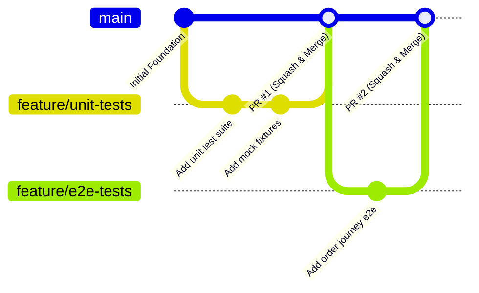

# Team Contribution & Engineering Governance

## 1. Overview

This document defines the team composition, role assignments, development workflow, and contribution accountability matrix for the **SE3112 Advanced Software Engineering** automated testing repository.

Every team member is responsible for upholding high engineering standards, writing maintainable test fixtures, participating in peer reviews, and contributing to the CI pipeline.

---

## 2. Team Roster & Module Responsibilities

> *Placeholder: Update with actual student names, registration numbers, and assigned components.*

| Student Name | Student ID | Designated Role | Primary Assigned Area |
| :--- | :--- | :--- | :--- |
| *[Member 1 Name]* | *[ITxxxxxxx]* | Team Lead / CI Architect | Pipeline orchestration, environment setup, architecture |
| *[Member 2 Name]* | *[ITxxxxxxx]* | QA Engineer - Unit & Mutation | Unit test harness, assertion design, mutation testing |
| *[Member 3 Name]* | *[ITxxxxxxx]* | QA Engineer - Integration & E2E | End-to-end user workflows, API contracts, test data |
| *[Member 4 Name]* | *[ITxxxxxxx]* | Performance & Security Engineer | Load testing scenarios, stress profiling, static security |

---

## 3. Contribution & Branching Workflow

To maintain a clean and reliable release history, all changes must follow standard Gitflow / trunk-based development principles with feature branching.

### 3.1 Branch Naming Conventions
- `feature/<category>-<short-description>` (e.g., `feature/unit-order-service`, `feature/load-k6-rush-hour`)
- `fix/<issue-description>` (e.g., `fix/ci-path-resolution`)
- `docs/<topic>` (e.g., `docs/update-traceability-matrix`)

### 3.2 Commit Message Standards (Conventional Commits)
Commits must be concise and descriptive following the Conventional Commits specification:
- `feat(unit): add boundary value tests for menu calculation`
- `feat(e2e): implement automated checkout journey test`
- `feat(load): configure 500-user ramp-up load script`
- `ci: configure test artifact publishing in github actions`
- `docs: update architecture diagram with event bus`

### 3.3 Pull Request & Code Review Process
1. **Self-Review**: Verify all tests pass locally before submitting PR.
2. **CI Verification**: GitHub Actions workflow must pass without failures.
3. **Peer Review**: At least one peer review approval is required prior to merging.
4. **No Direct Pushes to `main`**: All features must merge via reviewed pull requests.

---

## 4. Responsibility Matrix (RACI)

| Milestone / Deliverable | Member 1 | Member 2 | Member 3 | Member 4 |
| :--- | :---: | :---: | :---: | :---: |
| Repository & Pipeline Foundation | **A / R** | C | C | C |
| Unit Testing Implementation | C | **A / R** | I | I |
| Mutation Testing Strategy & Execution | C | **A / R** | I | I |
| E2E Test Suite & Workflows | C | I | **A / R** | I |
| Load & Stress Test Implementation | C | I | I | **A / R** |
| Static Code Analysis & Security Gates | **A / R** | C | C | **R** |
| Final Test Report Documentation | **A / R** | **R** | **R** | **R** |

*Legend: **R** = Responsible, **A** = Accountable, **C** = Consulted, **I** = Informed*

---

## 5. Peer Review Checklist

Before approving any test automation PR, reviewers must verify:
- [ ] Test scenarios clearly map to Cinnamon Bistro CSP requirements.
- [ ] Tests are deterministic and free of flaky timeouts or hardcoded delays.
- [ ] Test data and mocks do not leak sensitive information or credentials.
- [ ] Assertions verify business logic rather than trivial identity checks.
- [ ] Test reports and logs provide clear failure messages upon regression.

